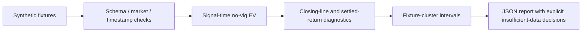

> **Proprietary - All Rights Reserved.** Licensed to Sandeep Grover. No reuse, copying, modification, or distribution without prior written permission. See LICENSE.

# Sports Odds Evaluation Specimen

An original, offline, synthetic Python demonstration of market checks, contemporaneous no-vig signal calculation, later closing-line measurement, and fixture-cluster uncertainty. It is a portfolio specimen, not a delivered client system or evidence of a betting edge. There are no real odds, proprietary datasets, API keys, bookmaker connections, placing-bet functions, or fund transfers.

## Architecture



## Run locally

Python 3.10+, standard library only. Repository visibility does not grant reuse permission; see LICENSE.

```sh
python main.py --output synthetic_report.json
python -m unittest discover -p 'test_*.py' -v
```

Thirteen tests check market mismatch, duplicate delivery, future-reference rejection, lack of closing-price leakage into signal EV, cluster count, invalid odds, reproducibility and refusal to qualify sports when evidence is absent.

The 806 generated rows yield 800 accepted synthetic signals and six excluded rows. Outcomes alternate win/loss by construction, so displayed returns are fixtures for exercising code, not market measurements.

## Method and honest limits

- Proportional no-vig normalization uses all mutually exclusive outcomes. Production requires settlement equivalence and sensitivity checks for alternative no-vig assumptions.
- Signal EV uses prices available at signal time. Closing prices are used only later for CLV diagnostics. Timestamps in this specimen are simple ordered integers; production needs authenticated provider timestamps and timezone normalization.
- CLV is defined here as offered decimal odds times no-vig closing probability minus one. This convention must be agreed before implementation; it is not interchangeable with a raw odds ratio.
- Equal-stake ROI intervals use a fixture-cluster percentile bootstrap (500 replicates). This is an illustrative estimator, not a precision-optimized statistical package. Production needs time/block dependence, settlement types, commission, held-out splits and sensitivity checks.
- Rule 1 is intentionally **INSUFFICIENT DATA**: testing Pinnacle calibration on selected value signals alone is biased. A separate full market universe and prespecified equivalence test are required. An interval including zero is not proof of equivalence within ±1.5 percentage points.
- Rule 2 remains diagnostic: this example does not select passing sports or assert pooled positive ROI. Selection and the final pooled 90% ROI test require independent held-out data and prespecified weighting.
- Rule 3 is intentionally **INSUFFICIENT DATA**: no actual accepted-bet logs are supplied. Thirty observations alone do not establish sufficient precision. No real betting is needed or performed to run this sample.
- The production acceptance criterion is faithful implementation and an honest PASS/FAIL/INSUFFICIENT DATA result. Profitability is not guaranteed.

## Production source boundary

The proposed adapter is separate work. Official OddsPapi v4 documentation specifies fixture-level historical odds, up to three bookmakers per request, a five-second cooldown, and timestamps/active flags/limits. The sample does **not** implement this adapter or validate account-specific coverage.

Sources reviewed 1 November 2026:

- https://oddspapi.io/en/docs/get-historical-odds
- https://oddspapi.io/en/legal/terms

The client must run the licensed collector in their own authorized environment, keeping their personal API key there. Alternatively use provider-approved delegated access or permitted exports. No sharing of personal API keys or republication of licensed odds is proposed. Availability, quotas, bookmaker/market coverage and permitted processing remain account-specific checks in the paid first milestone.
